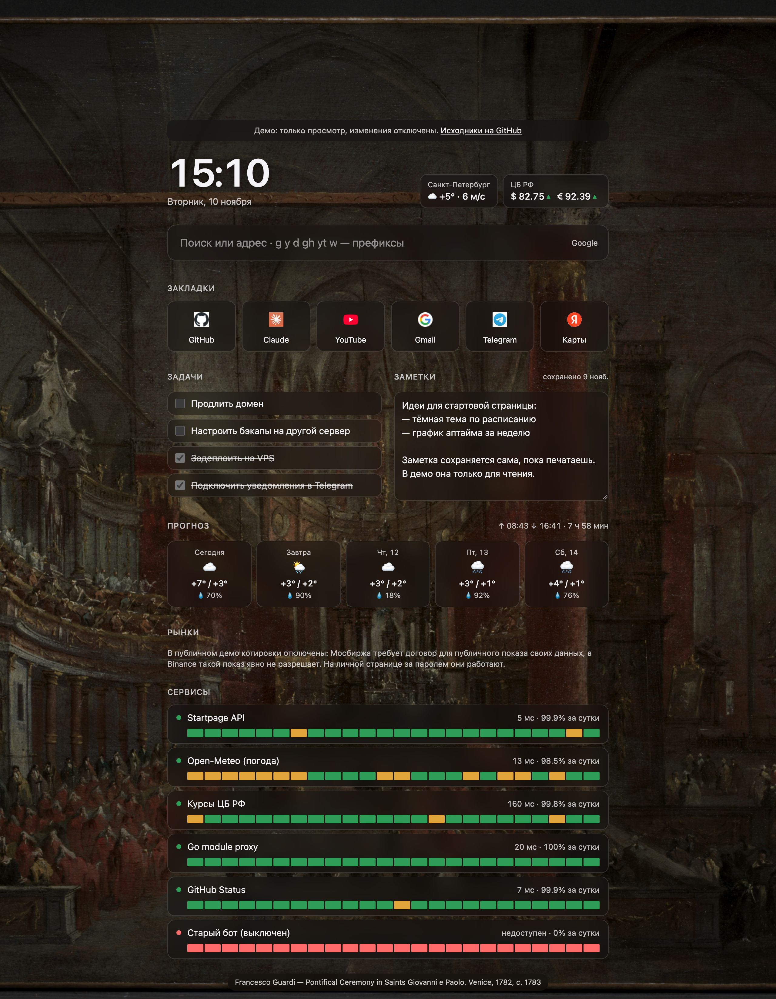

# startpage

[](https://github.com/mgrubiyan/startpage/actions/workflows/ci.yml)

A self-hosted browser start page with a Go backend: search with live suggestions,
bookmarks, clock, weather, Central Bank of Russia exchange rates and an uptime
monitor for your own services (Telegram bots, APIs, anything with an HTTP endpoint).
The background is a public-domain painting of the day.

**Live demo: [demo.mgrubiyan.ru](https://demo.mgrubiyan.ru)** (read-only, no login).

The frontend is plain HTML/CSS/JS embedded into the binary. All data comes from
the Go JSON API; the browser doesn't call third-party APIs. The one exception is
bookmark icons, which load from Google's favicon service, so bookmark hostnames
are visible to Google.



## Features

- **Search**: default engine plus prefixes (`g`, `y`, `d`, `gh`, `yt`, `w`), address detection,
  suggestions proxied from Google (DuckDuckGo fallback) with keyboard navigation.
- **Weather and rates**: current weather, a five-day forecast with sunrise,
  sunset and day length (Open-Meteo), and the CBR daily feed, cached server-side.
  Forecast days and sun times are in the city's own time zone, not the server's
  or the browser's.
- **Markets**: up to 8 coins of your choice (BTC, ETH, SOL and TON by default) from
  Binance, falling back to Bybit, and the IMOEX index with up to 8 Moscow Exchange
  shares (15 minutes delayed, as its free data is). The lists live in the settings;
  a ticker an exchange doesn't know is named under its board instead of emptying
  it. Each exchange is cached on its own, so one being down still shows the other. Off on the public demo: MOEX requires a contract to display its
  data to the public, and Binance has no policy that clearly allows it, while a
  personal instance behind a login is plain personal use.
- **Painting of the day**: a public-domain (CC0) work from the Cleveland Museum of Art as the
  background, under a dark glass theme, with a caption linking to the museum's page.
- **Bookmarks and settings**: stored in Postgres.
- **Tasks and notes**: a to-do list and a scratchpad that saves itself as you type.
- **Service monitor**: background prober with latency, last error and 24h uptime per service,
  plus optional Telegram alerts when a service goes down or comes back.
- **Single-user login**: password, server-side sessions, rate-limited.
- **Demo mode**: a public read-only instance with no login, for showing the project.
- **Chrome extension**: makes every new tab open the start page.

## Architecture

```
cmd/startpage            wiring, config, graceful shutdown, `healthcheck` subcommand
internal/config          env config with validation (all errors reported at once)
internal/httpapi         net/http ServeMux routes, middleware, handlers, DTOs
internal/auth            bcrypt password check, session tokens, login rate limiter
internal/cache           generic TTL cache: singleflight, stale-on-error, bounded size
internal/fetch           shared HTTP client + JSON helper with body size limit
internal/weather         Open-Meteo geocoding + forecast client
internal/rates           CBR daily rates client
internal/markets         Binance, Bybit and MOEX ISS quote clients, with fallback
internal/suggest         search suggestions client (Google → DuckDuckGo fallback)
internal/art             painting of the day: Cleveland Museum of Art Open Access client + daily holder
internal/monitor         ticker-driven prober with a bounded worker pool, down/up alerts
internal/telegram        Telegram Bot API client for the alerts
internal/demo            monitor targets seeded into an empty demo database
internal/store           domain types
internal/store/postgres  pgx/v5 store, embedded SQL migrations
web/static               frontend, embedded with go:embed
extension                MV3 new-tab extension that redirects to the server
deploy                   VPS setup: Caddy + shared Postgres, app compose, backups
```

Only the standard library is used for HTTP and logging (`net/http` 1.22+ method
patterns, `log/slog`). Third-party dependencies are `pgx/v5`,
`golang.org/x/sync/singleflight` and `golang.org/x/crypto/bcrypt`.

### Design notes

**Painting of the day.** The server picks it and serves the image itself, so the browser still
talks only to its own origin and the CSP stays `img-src 'self'`.
- The pick is a hash of the UTC date: the same day gives the same painting on every instance and
  after restarts. Days rotate between the museum's three easel-painting departments, because
  it also files manuscript leaves and scrolls under "Painting".
- Only large landscape works between 1.2:1 and 2:1 pass, so the image fills a screen without
  losing most of itself to the crop.
- Every URL from the museum's JSON is checked before use: images only from the museum's CDN
  over https (redirects included), caption links only to clevelandart.org. The download is
  capped at 8 MB and must sniff as JPEG.
- `art.Daily` loads once a day. If the museum is down it keeps yesterday's painting and retries
  after a backoff instead of on every request.
- The image URL carries the painting's id, so the browser caches it for a day (`private`,
  since a personal instance is behind the login). Any other URL stays `no-store`.

**Notes.** The scratchpad saves itself 0.7 s after you stop typing, when it loses focus, and
when the tab is hidden (as a `keepalive` request, so closing the tab doesn't lose the last words).
- One save is in flight at a time, and the next one sends whatever was typed meanwhile. Two
  saves can't land out of order and leave older text on the server.
- Every new tab is a start page, so several copies are usually open. A tab re-reads the note
  when it becomes visible, but never overwrites the textarea while it has edits the server
  hasn't seen. With two windows edited side by side, the last save wins.
- The text is stored as typed: no trimming, line breaks and tabs kept, CRLF turned into LF,
  other control characters refused. 10 000 characters, checked by the API and by a `CHECK`.

**Upstream caching.** `cache.Cache[V]` wraps every external API.
- Concurrent misses for the same key collapse into one upstream call (`singleflight`).
- The load runs on a context detached from the request (`context.WithoutCancel` plus its own
  timeout), so one impatient client can't cancel a fetch that other waiters share.
- Errors are never cached. If a refresh fails while an expired value exists, the stale value
  is served with `"stale": true` and the UI marks it.
- After a failed refresh, the stale value is served immediately for 30s, so a dead upstream
  doesn't make every request wait out the timeout.
- Suggestions give each provider its own timeout, so a hanging Google still leaves time for
  the DuckDuckGo fallback.
- Entry count is bounded; weather is keyed by city, suggestions by query.

**Auth.**
- The password from `STARTPAGE_PASSWORD` is stored only as a bcrypt hash. At startup the app
  compares it with the stored hash. If the password was changed, every session is deleted, so a
  leaked password stops working for anyone already logged in once it is rotated.
- A session is 32 random bytes sent as an `HttpOnly`, `SameSite=Lax` cookie (`Secure` is configurable).
  Only its SHA-256 is stored, so a database leak doesn't hand out live sessions.
  Expired sessions are pruned on login.
- Login is rate-limited per client IP (5/min). `X-Forwarded-For` is honoured only with
  `STARTPAGE_TRUST_PROXY=true`, and then only its last entry, which the proxy appended.
  Never enable it while the app port is reachable directly, because clients could then pick
  their own IP. The limiter tracks at most 10k clients; past that it refuses new ones rather
  than grow.
- API responses carry `Cache-Control: no-store`.
- Routes are declared in one table with an explicit `public` flag. A test walks that table and
  asserts that every private route returns 401 without a valid cookie, so a new endpoint can't
  ship unauthenticated by accident.

**CSRF.**
- Mutating requests must be `application/json`, which a cross-site form can't send without a
  CORS preflight.
- The session cookie is `SameSite=Lax`.

**Hardening.**
- A strict CSP: `script-src 'self'`, no inline scripts.
- JSON 404/405 for API routes.
- 64 KiB request body limit; unknown JSON fields rejected.
- Timeouts on the HTTP server and on every outbound call.

**Monitor.**
- Each round probes all services through a pool of 4 workers.
- Each probe has a 5s timeout, follows at most 3 redirects and reads at most 64 KiB of body.
- 2xx/3xx counts as up.
- Adding or removing a service triggers a round immediately.
- Results are written in one batch.
- Check history older than 7 days is pruned hourly.
- On shutdown, an interrupted round is dropped rather than recorded as a burst of false failures.
- Telegram alerts (`TELEGRAM_BOT_TOKEN` + `TELEGRAM_CHAT_ID`, off when unset):
  - A service counts as down after 2 failed checks in a row, so one lost probe stays quiet.
    Each outage alerts once, and the recovery message says how long it lasted.
  - All changes from one round go out as one message. If Telegram can't be reached, they are kept
    and sent with the next round.
  - At startup the state comes from the checks of the last few rounds, so a deploy doesn't
    repeat the alert for a service that is still down. A failure that wasn't reported yet still
    is: when unsure, a duplicate alert beats a missed one.
  - Messages are plain text: the service name and the probe error, which can name the host
    (`connection refused` on `10.0.0.5:8081`). The token is never logged: errors drop the
    request URL that contains it.
  - The demo refuses these settings: it watches a service that is down on purpose.

**Migrations.** Plain numbered `.sql` files embedded in the binary.
- Applied at startup under `pg_advisory_lock`, so several replicas can start at once.
- Each migration runs in its own transaction.

### Monitor and SSRF

The monitor fetches URLs that the user enters, which is server-side request forgery by
definition. It deliberately **allows** private and loopback addresses, because watching your
own bots on `localhost` or a LAN is the whole point. This is acceptable because:

- only the single authenticated owner can add services;
- probes are `GET` only, and the response body is discarded, never shown back. The UI gets
  just status, latency and a short error string.

If you expose startpage to other users, add an address allow-list in `internal/monitor`
before doing so.

### Demo mode

`STARTPAGE_DEMO=true` turns an instance into a public showcase:

- No login and no password. Every `GET` route is open, and every write, login included,
  answers `403`. The policy lives in one place (`guard` in `internal/httpapi/server.go`), and a
  test walks the route table to prove that no write gets through.
- Because nobody can add services, the SSRF concern above doesn't apply. On an empty database
  the demo seeds its own monitor targets (`internal/demo`), including one that is always down.
- Search suggestions are limited to 60 requests per minute per IP, so the demo can't be used as
  a free suggestions proxy. Behind a reverse proxy, set `STARTPAGE_TRUST_PROXY=true` (and keep
  the app port private), or every visitor shares the proxy's IP and one limit.
- `STARTPAGE_DEMO` together with `STARTPAGE_PASSWORD` is a config error, so a real instance
  can't be turned into a public one by flipping a flag.
- The frontend reads `GET /api/meta`, shows a banner and hides the edit controls.

Run the demo as a separate instance with its own database, never against your real data.

## API

All endpoints except login, logout and meta require the session cookie (in demo mode, reads
are open and writes are refused). JSON in, JSON out.

| Method | Path | Description |
|---|---|---|
| `POST` | `/api/login` | `{"password": "..."}` → sets the session cookie (204) |
| `POST` | `/api/logout` | deletes the session |
| `GET` | `/api/meta` | `{"demo": false}`: how the server runs (public) |
| `GET` / `PUT` | `/api/settings` | `{"searchEngine": "g", "city": "Санкт-Петербург", "crypto": ["BTC", "ETH"], "shares": ["SBER"]}`; a list left out of a `PUT` is kept |
| `GET` / `POST` | `/api/bookmarks` | list / add `{"title", "url"}` |
| `DELETE` | `/api/bookmarks/{id}` | |
| `GET` / `PUT` | `/api/note` | the scratchpad: `{"text"}` → `{"text", "updatedAt"}` |
| `GET` / `POST` | `/api/tasks` | open tasks first, then done ones / add `{"title"}` |
| `PATCH` | `/api/tasks/{id}` | `{"done": true}` or `false` |
| `DELETE` | `/api/tasks/{id}` | |
| `DELETE` | `/api/tasks/completed` | removes every done task: `{"deleted": n}` |
| `GET` / `POST` | `/api/services` | list with last check, 24h uptime and `history` (24 hourly slots: checks, passed, average latency) / add `{"name", "url"}` |
| `DELETE` | `/api/services/{id}` | |
| `GET` | `/api/weather` | current weather and a five-day forecast (`days`, with sunrise/sunset) for the configured city |
| `GET` | `/api/rates` | USD and EUR from the CBR, with previous values |
| `GET` | `/api/markets` | crypto and MOEX boards for the settings' tickers, each with its source, delay, `stale`/`error` and the `missing` tickers; `available: false` with a `reason` on the demo |
| `GET` | `/api/suggest?q=` | search suggestions |
| `GET` | `/api/art` | today's painting: `{"title", "artist", "date", "url", "image"}` |
| `GET` | `/api/art/image?v=` | the painting as JPEG (the one non-JSON response) |
| `GET` | `/healthz` | liveness + database ping (public) |

## Running

### Docker Compose

```sh
cp .env.example .env    # set STARTPAGE_PASSWORD and POSTGRES_PASSWORD
docker compose up -d --build
open http://localhost:8080
```

The app is published on `127.0.0.1` only. To watch a service running on the Docker host, use
`http://host.docker.internal:PORT/...` as its URL.

### Locally

```sh
make test-db    # throwaway Postgres 17 in Docker on 127.0.0.1:55432
make run        # password: correct-horse (override with STARTPAGE_PASSWORD)
make run-demo   # the same, in read-only demo mode
```

### Configuration

| Variable | Default | |
|---|---|---|
| `DATABASE_URL` | (required) | Postgres connection string |
| `STARTPAGE_PASSWORD` | (required) | login password, 8 to 72 bytes; must be unset in demo mode |
| `STARTPAGE_DEMO` | `false` | public read-only demo, see [Demo mode](#demo-mode) |
| `STARTPAGE_ADDR` | `:8080` | listen address |
| `STARTPAGE_SECURE_COOKIE` | `false` | set `true` behind HTTPS |
| `STARTPAGE_TRUST_PROXY` | `false` | use the last `X-Forwarded-For` entry as client IP |
| `STARTPAGE_SESSION_TTL` | `720h` | session lifetime |
| `STARTPAGE_MONITOR_INTERVAL` | `1m` | probe interval (min `5s`) |
| `TELEGRAM_BOT_TOKEN` | (none) | bot token from @BotFather; enables monitor alerts |
| `TELEGRAM_CHAT_ID` | (none) | chat to alert, set together with the token |
| `LOG_LEVEL` | `info` | `debug`, `info`, `warn`, `error` |

### On a server

[deploy/README.md](deploy/README.md) covers a VPS:
- Caddy with automatic TLS;
- one shared Postgres with a role and database per app;
- the personal instance next to the public demo;
- daily backups;
- optional deploys from CI. Images are published to GHCR on every push to `main`.

### New-tab extension

1. Open `chrome://extensions` and enable **Developer mode**.
2. Click **Load unpacked** and pick the `extension/` folder.
3. If the server is not on `http://localhost:8080/`, edit `STARTPAGE_URL` in `extension/newtab.js`.

## Tests

```sh
make test               # unit tests with -race; Postgres tests skip
make test-db            # once
make test-integration   # everything, including Postgres
make e2e                # the page in a real browser (Playwright, needs Node)
make lint               # go vet + golangci-lint
```

- Handlers are tested through `httptest` with in-memory fakes.
- Upstream clients are tested against `httptest.Server` fixtures.
- The cache and monitor tests exercise concurrency under `-race`: singleflight collapse,
  stale fallback, shutdown mid-round.
- Postgres tests run against a real database. Each test gets its own schema, so they run in
  parallel.
- Browser tests (`e2e/`, Playwright) start the real server against Postgres and check what
  only a browser shows: logging in and out, a checked task staying under the cursor, the note
  saving itself and staying locked until loaded, and a new tab opening from the last-known
  data while the API is held back. Third-party widgets are left out: they'd make CI flaky.

CI runs vet, the full suite with a Postgres service container, golangci-lint, a Docker build and
the browser tests.
On `main` it also publishes the image to GHCR, and deploys it when a server is configured.

## License

[MIT](LICENSE)
